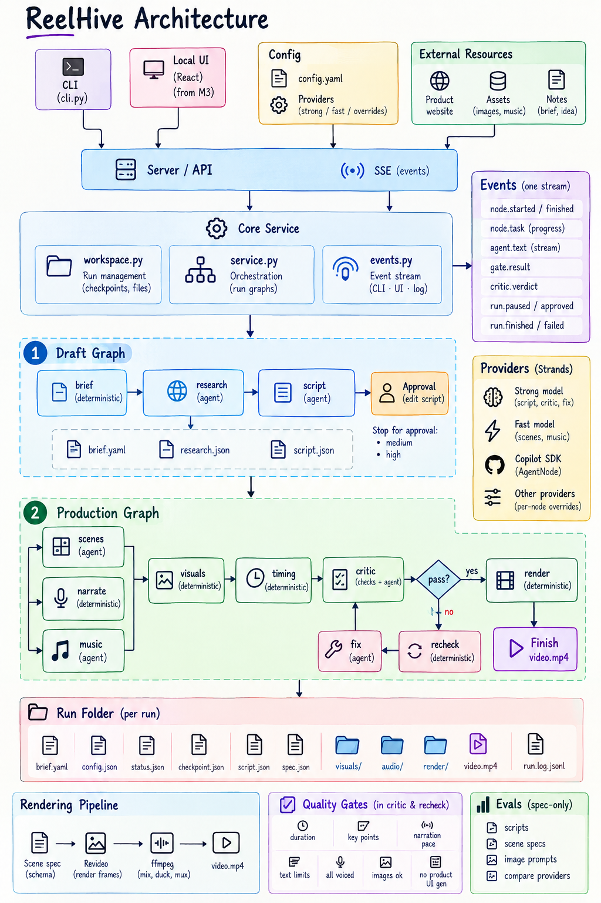

# Architecture

ReelHive turns a brief into a video in two Strands graphs (and publishes it with two more), driven by one core service that the CLI (and, from M3, the local UI) sit on top of.



```
CLI (cli.py) ─────────────────────────────┐
UI (React) ─► server/ ─► core/workspace.py ┴─► core/service.py ─► draft graph ─(stop: medium, high)─► production graph ─(stop: high)─► finish          │
                          └──► core/events.py ──► CLI progress · UI stream · run.log.jsonl
```

## The two graphs

A Strands graph runs to completion, so human approval points sit between graph runs.

```
draft:        brief ─► research ─► script

production:   ┌─► scenes ─► visuals ─┐
              ├─► narrate ───────────┼─► timing ─► critic ─┬─(pass)──────────────────────► render ─► review ─┬─(pass)─► sound ─► master
              └─► music ─────────────┘                     └─(fail)─► fix ─► recheck ─(pass)─┘                │
                                                                      ▲                                       │
                                                                      └──────────(fail, rounds left)──────────┘
```

`critic` judges the plan before anything is drawn. `review` judges the cut the renderer actually drew and sends it back through `fix` when it falls short, so the production graph is a real cycle: the builder resets revisited nodes (`reset_on_revisit`), a failed review reopens `fix`, `recheck` and `render` in the run's checkpoint, a new render reopens `review`, `sound` and `master`, and `MAX_REVIEW_ROUNDS` (2) plus the execution cap bound the loop. The edges read the run's state, so a run resumed after a crash re-enters the loop where it was instead of re-rendering an unrepaired cut.

| Node | Kind | Job | Code |
| --- | --- | --- | --- |
| `brief` | deterministic | Validate, fill the level's defaults, make paths absolute, save `brief.yaml` | `nodes/brief_node.py` |
| `research` | agent, fast + crawl | Read the product website (same origin, ≤10 pages, masks honoured) and the brief's documents, and write `research.json`: what it is, correct names, offerings, pains, facts, what each note refers to. Uses a public App URL when no website is given; skipped with no source | `agents/researcher.py` |
| `script` | agent, strong | Narration as beats, one beat per shot: the count comes from the duration and the pacing's shot length, and its output model holds the writer to it | `agents/script_writer.py` |
| `scenes` | agent, fast | Director as well as designer: a template, on-screen text, a visual request (with a close-up region), a `layout` and a `hold` per beat; the intro opens the video (after the hook with `cold_open`) | `agents/scene_planner.py` |
| `visuals` | deterministic | Resolve each visual request: provided image, screenshot or generated image, else a text fallback | `visuals/resolver.py` |
| `narrate` | deterministic | Kokoro TTS per beat, recording real durations and word timings (for captions) | `nodes/narrate_node.py` |
| `music` | agent, fast + lookup | Mood and BPM, then the closest track in `assets/music` | `agents/music_director.py` |
| `timing` | deterministic | Scene starts and lengths from real audio, padded to the target | `nodes/timing_node.py` |
| `critic` | hard checks + agent | Deterministic gates first; only if they pass, a rubric review | `agents/critic.py` |
| `fix` | agent, strong | Repair the scene plan against the failures | `agents/fixer.py` |
| `recheck` | deterministic | Re-voice changed scenes, re-resolve visuals, re-time, run the gates again | `nodes/recheck_node.py` |
| `render` | deterministic | Revideo draws the silent cut and reports the layout it measured on screen (`render/layout.json`) | `nodes/render_node.py`, `render/bridge.py` |
| `review` | layout gates + optional vision agent | Gates on the measured geometry first; then, only when the brief opts in (`frame_review`), a vision agent scores one settled frame per shot | `agents/reviewer.py`, `render/frames.py` |
| `sound` | agent, fast | Scores the approved cut with a few effects, or none, on the moments the renderer reported; the rules (budget, spacing, quiet under the voice) are validators of its per-run output model | `agents/sound_designer.py` |
| `master` | deterministic | ffmpeg mixes narration, ducked music and effects and muxes them onto the reviewed cut; writes `video.srt`/`video.vtt` and a soft subtitle track | `nodes/master_node.py`, `audio/mixer.py`, `render/subtitles.py` |

Deterministic nodes never call an LLM. Agent nodes return Pydantic-validated structured output; the image prompts are written by `scenes`, and `visuals` only executes them.

## Publishing

Publishing is two more graphs, run only when the user asks, with a person approving the copy between them (a post goes out under their name):

```
copy:   ready ─(gates pass)─► publish
post:   ready ─(gates pass)─┬─► post_youtube
                            ├─► post_linkedin       in parallel; each saves its result as it lands
                            ├─► post_tiktok
                            └─► post_instagram
```

`ready` (deterministic) checks the finished video, each developer app's credentials, the signed-in accounts and each platform's video rules before any model call or upload. `publish` (agent, strong) drafts the copy with an output model built from the chosen platforms, so each block is held to its platform's limits. The `post_<platform>` nodes upload through `publish/platforms/`; a platform that fails doesn't stop the others, and one already live is never posted again. See [publishing.md](publishing.md).

## Notes in, story out

The brief is raw material. The writers get the notes numbered, the product research when there is a website, and the closing as an idea to polish. They decide how to tell the notes and write their own copy. The critic's rubric judges the story, spelling of names, invented facts and whether the call to action is finished; the hard checks below only verify structure.

## Hard checks

`critic` runs these before it spends a token, and `recheck` runs them again after `fix`:

- total duration within ±5% of the target;
- every key-point note told by at least one scene (scenes record the notes they tell in `covers`; wording is free);
- narration pace within the brief's `pacing` range (`slow` 100-135, `balanced` 130-170, `fast` 145-175 words per minute of video, not counting the intro, the credit, planned holds or the short pause between beats; the floor follows the voice's measured rate, so a slow voice isn't asked for the impossible);
- on-screen text within each template's limits;
- shot length: no screen held longer than the pacing allows (8 s balanced), and about one change every 5.5 s on average, so the picture keeps moving while the voice goes on;
- reading time: at most four on-screen words per second a scene is settled on screen;
- every scene voiced with its current narration;
- every image present, inside the run folder and at the format's minimum resolution;
- no generated image in a `product_ui` scene.

If `recheck` still fails, the plan goes back to `fix` (a bounded cycle: at most `MAX_PLAN_REPAIRS`, 3, fixes in a row), so a near miss such as a shot 0.1 s too long is repaired rather than fatal. After the last repair no edge is satisfied, the graph ends, and the service stops the run with the failure report instead of rendering a bad video.

## Reviewing the cut

`review` checks what was drawn, cheapest first, like `critic`:

1. **Layout gates**, on the geometry the renderer measured once each shot had settled (no model call): every shot measured; text inside a 4% title-safe margin and visuals inside the frame; no text colliding with other text, a visual or the logo; text at least 2.2% of the frame's short side (24 px at 1080, readable on a phone); images enlarged at most 1.35× (the camera caps itself at 1.3×).
2. **Frame review**, only when those pass and the brief sets `frame_review`: one settled still per shot goes to a vision model, which scores focal point, hierarchy, readability, composition and consistency and names fixes per scene. This sends the frames to your provider, so it is off by default; with Copilot (text only) it is skipped.

A failure goes to `fix` with scene-numbered reasons. The fixer can shorten copy, change a scene's template, `layout`, `hold` or close-up region; `recheck` re-voices and re-times, and the cut is drawn again.

## The render contract

`schemas/scene_spec.py` is the contract between Python and the Node renderer. Pydantic exports it to `renderer/src/spec.schema.json` (`make schema`), and the renderer reads its character limits from that file, so there is one source of truth. A contract test fails if the two drift. Agents never write renderer code; they fill this spec. The spec also carries the motion timings (`motion.enter`, `motion.transition`), so the reading-time gate and the renderer agree on when a shot has settled.

The contract runs the other way too: `schemas/layout.py` is the shape of the layout report. The renderer prints one `REELHIVE_LAYOUT` line per shot, the bridge collects them into `render/layout.json`, and Python validates every line. Contract tests keep the marker, the element roles and the camera's sharpness cap in step with the review gates.

The renderer owns how things move, in one language for the whole video: elements arrive in reading order on an exact-length spring curve, and each cut is chosen from what meets there (the device carried from one product shot to the next, a settle into the intro and the closing, a push otherwise). Frame geometry (safe box, type scale) lives in `renderer/src/stage.ts`, so every template shares margins and hierarchy.

## Run folder

Every run is written to disk, which makes it reproducible and resumable:

```
runs/2026-10-08T15-30-00-123456_cloud-bills-grow-silently/
├── brief.yaml        # normalized brief
├── config.json       # provider config, so `approve` resumes on the same models
├── status.json       # queued | drafting | awaiting_script | producing | awaiting_scenes | done | stopped | failed | cancelled | interrupted
├── checkpoint.json   # completed nodes and state, so `reelhive resume` continues after a crash or cancel
├── script.json       # the script (edit it before `reelhive approve` at medium)
├── spec.json         # the final scene spec
├── visuals/          # copied, captured or generated images; clips/ (normalized clips), posters/
├── audio/            # scene_XX.wav, narration.wav, effects.wav, mix.wav
├── documents/        # pages rendered from the brief's PDFs and decks
├── render/           # silent.mp4, layout.json (measured layout), frames/ (stills for the frame review)
├── video.mp4         # with a soft English subtitle track when narrated
├── video.srt, video.vtt
├── publish/          # job.json: the drafted posts and what each became (only after `reelhive publish`)
└── run.log.jsonl     # every event
```

## Events

`core/events.py` defines one stream. The CLI prints it, the UI (M3) will receive it over server-sent events, and every event lands in `run.log.jsonl`, so past runs can be replayed.

| Event | Carries |
| --- | --- |
| `node.started` / `node.finished` / `node.skipped` | node, status, seconds, tokens |
| `node.task` | one human-readable progress line, optionally `progress` 0-1 |
| `agent.text` | streamed model text |
| `gate.result` | check, value, threshold, passed |
| `critic.verdict` | rubric scores, passed, reasons |
| `review.verdict` | frame review scores, passed, reasons (only with `frame_review`; layout gates arrive as `gate.result` from `review`) |
| `fix.diff` | before/after of each changed scene |
| `run.paused` / `script.approved` | approval stop and resume |
| `suggestion.offered` / `suggestion.applied` / `version.restored` | M6 quick actions: what was offered (cached or not), which was applied, and undo |
| `run.finished` | video path and duration, or the stop report |
| `publish.drafted` / `publish.posted` / `publish.failed` | publishing: the drafted job (platforms, gates), one platform's live post (link, notes) or its failure |

## Providers

`providers/factory.py` turns `config.yaml` into a Strands model per tier (strong: script, critic, fix, review; fast: research, scenes, music), with optional per-node overrides. GitHub Copilot is not a Strands model: `AgentNode` hands its work to `CopilotAgentNode`, which runs a locked-down Copilot SDK session with a single submit tool. See [providers.md](providers.md) and [copilot-sdk.md](copilot-sdk.md).

## Evals

`evals/` runs the same graphs in spec-only mode to score scripts, specs and image prompts per provider. See [evals/README.md](../evals/README.md).

## Built on

[Strands Agents](https://strandsagents.com), [Kokoro](https://huggingface.co/hexgrad/Kokoro-82M), [Revideo](https://re.video), [Playwright](https://playwright.dev), [ffmpeg](https://ffmpeg.org), [CopilotKit](https://www.copilotkit.ai) and the [GitHub Copilot SDK](https://github.com/github/copilot-sdk).
